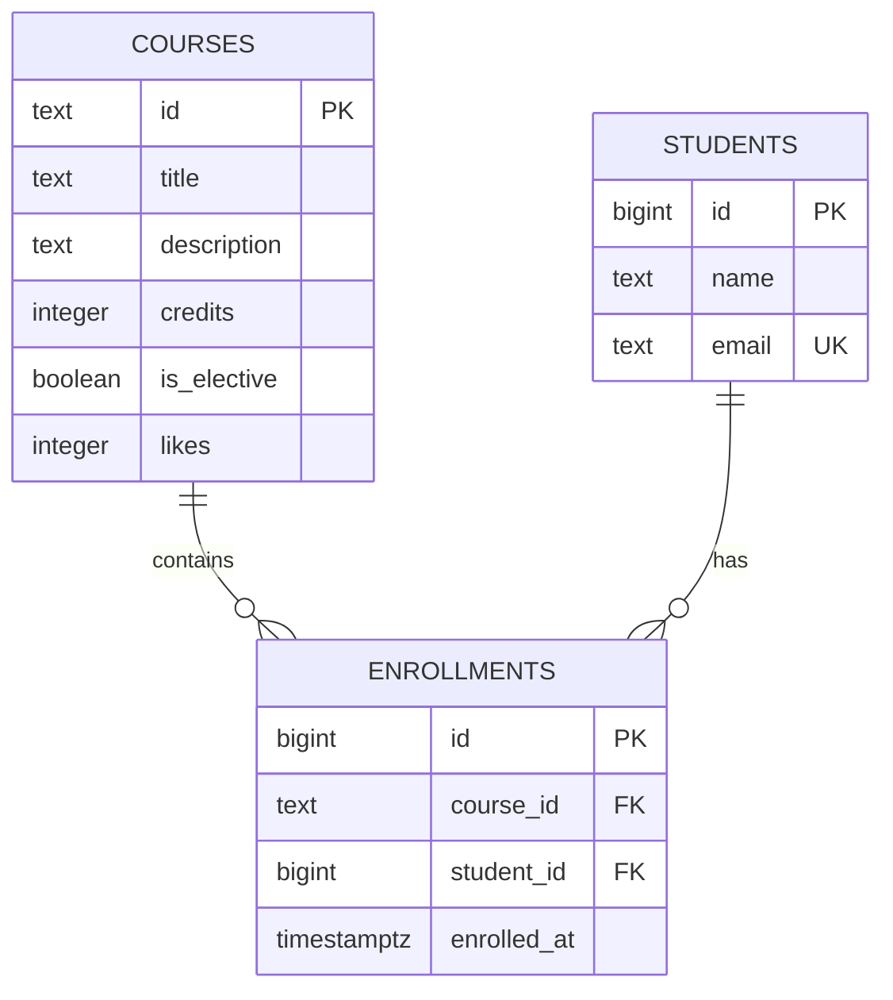

# Course Catalog Database — Lab 6

## 1. Project Overview

This project implements a relational database for a Course Catalog application using PostgreSQL.

Previously, course and enrollment information was stored in Python lists in the backend. In this lab, the data was moved into PostgreSQL to provide persistent storage, data consistency, and better data management.

The database consists of three main tables: `courses`, `students`, and `enrollments`.

The project demonstrates database schema design, primary and foreign keys, constraints, SQL queries, indexing, transactions, normalization, and SQL injection prevention.

## 2. Technologies Used

- PostgreSQL 18.6
- pgAdmin 4
- SQL
- Visual Studio Code
- Git and GitHub

## 3. Project Structure

```text
course-catalog-db/
│
├── schema.sql
├── seed.sql
├── queries.sql
├── README.md
│
└── experiments/
    ├── idx_data.sql
    └── norm_demo.sql
```

## 4. Database Schema

The database contains three related tables.

### Courses

Stores information about available courses.

| Column | Data type | Description |
|---|---|---|
| id | TEXT | Primary key |
| title | TEXT | Course title |
| description | TEXT | Course description |
| credits | INTEGER | Number of credits |
| is_elective | BOOLEAN | Indicates whether the course is elective |
| likes | INTEGER | Number of likes |

### Students

Stores registered student information.

| Column | Data type | Description |
|---|---|---|
| id | BIGINT | Generated primary key |
| name | TEXT | Student name |
| email | TEXT | Unique student email |

### Enrollments

Connects students with courses.

| Column | Data type | Description |
|---|---|---|
| id | BIGINT | Generated primary key |
| course_id | TEXT | Foreign key referencing courses |
| student_id | BIGINT | Foreign key referencing students |
| enrolled_at | TIMESTAMPTZ | Enrollment timestamp |

### Entity Relationship Diagram



## 5. Design Decisions

### Course ID and Student ID

The `courses` table uses a TEXT primary key because course identifiers are readable slugs, such as `modern-frontend` and `api-design`. This makes them convenient to use in API URLs.

The `students` table uses BIGINT with GENERATED ALWAYS AS IDENTITY because student identifiers are generated automatically by PostgreSQL.

### ON DELETE RESTRICT and CASCADE

The course foreign key uses `ON DELETE RESTRICT`. This prevents a course from being deleted while students are still enrolled in it.

The student foreign key uses `ON DELETE CASCADE`. When a student is deleted, their enrollment records are automatically removed.

### TIMESTAMPTZ and TEXT

`TIMESTAMPTZ` is used for enrollment dates because it supports time-zone-aware timestamps.

TEXT is used for names, titles, descriptions, and emails because PostgreSQL does not require a fixed maximum length for these fields. Additional validation is provided through constraints.

## 6. Initial Data

The `seed.sql` file inserts the initial sample data.

After running `schema.sql` and `seed.sql`, the database contains:

| Table | Number of records |
|---|---:|
| courses | 6 |
| students | 3 |
| enrollments | 6 |

The sample data includes three students and six courses with different credit values, elective statuses, and like counts.

## 7. SQL Queries for API Routes

The `queries.sql` file contains SQL queries corresponding to the Course Catalog API operations.

| Query | API operation | Description |
|---|---|---|
| 1 | GET /courses | Retrieves the first page of courses |
| 1b | GET /courses | Retrieves the second page |
| 2 | GET /courses/{course_id} | Retrieves one course |
| 2b | GET /courses/{course_id} | Tests a nonexistent course |
| 3 | POST /courses/{course_id}/like | Increments course likes |
| 4 | POST /enrollments | Creates a student enrollment |
| 5 | GET /enrollments | Retrieves enrollments with student and course information |
| 6 | Statistics | Counts enrollments for every course |

The course listing uses `WHERE`, `ORDER BY`, `LIMIT`, and `OFFSET` to filter, sort, and paginate the results.

The enrollment query uses INNER JOIN to combine information from the three tables.

The statistics query uses LEFT JOIN and COUNT to include courses that have no enrollments.

The queries that modify data are wrapped in `BEGIN` and `ROLLBACK` so that they can be tested repeatedly without permanently changing the sample data.

## 8. Constraint Violation Experiments

Ten deliberate constraint violations were tested to verify that PostgreSQL prevents invalid data from entering the database.

The SQLSTATE codes were used to identify the type of database error and determine the appropriate HTTP response for the API.

| # | Experiment | SQLSTATE | Constraint / Column | HTTP response |
|---:|---|---|---|---|
| 1 | NULL course title | 23502 | title (NOT NULL) | 422 Unprocessable Entity |
| 2 | Zero course credits | 23514 | courses_credits_check | 422 Unprocessable Entity |
| 3 | Negative likes | 23514 | courses_likes_check | 500 Internal Server Error |
| 4 | Student name with one character | 23514 | students_name_check | 422 Unprocessable Entity |
| 5 | Duplicate student email | 23505 | students_email_key | 409 Conflict |
| 6 | Duplicate course ID | 23505 | courses_pkey | 409 Conflict |
| 7 | Duplicate student-course enrollment | 23505 | enrollments_course_id_student_id_key | 409 Conflict |
| 8 | Enrollment in nonexistent course | 23503 | enrollments_course_id_fkey | 404 Not Found |
| 9 | Enrollment for nonexistent student | 23503 | enrollments_student_id_fkey | 404 Not Found |
| 10 | Deleting a course with enrollments | 23001 | enrollments_course_id_fkey | 409 Conflict |

### ON DELETE CASCADE Experiment

The cascade experiment tested what happens when a student with existing enrollments is deleted.

Daniyar Bekov had three enrollments. After deleting him, the enrollment count changed from 6 to 3 because PostgreSQL automatically removed his related enrollment records.

After executing ROLLBACK, the original data was restored and the enrollment count returned to 6.

This demonstrates how ON DELETE CASCADE maintains referential integrity.

### Why Validate Data in Both Pydantic and PostgreSQL?

Pydantic validates incoming data in the application and provides useful error messages to users.

However, the database also needs its own constraints because data may be inserted through other applications, scripts, or direct SQL commands. Database constraints provide the final protection and prevent invalid data from bypassing application-level validation.

## 9. Indexing Experiment

The indexing experiment was performed using a separate database named `idx_demo`.

A larger dataset was generated to compare query performance before and after creating an index.

### Experimental Dataset

| Table | Number of records |
|---|---:|
| Courses | 500 |
| Students | 20,000 |
| Enrollments | 50,000 |

The data was generated using PostgreSQL's `generate_series()` function.

### Query Plan Comparison Before Indexing

Three queries were examined.

**1. Searching by student email**

```sql
EXPLAIN
SELECT *
FROM students
WHERE email = 'student777@example.com';
```

Result: `Index Scan using students_email_key`.

The UNIQUE constraint on email automatically created an index.

**2. Searching by course ID**

```sql
EXPLAIN
SELECT *
FROM enrollments
WHERE course_id = 'course-7';
```

Result: `Bitmap Index Scan on enrollments_course_id_student_id_key`.

The composite index on `(course_id, student_id)` can also support searches using its first column.

**3. Searching by student ID**

```sql
EXPLAIN
SELECT *
FROM enrollments
WHERE student_id = 777;
```

Result:

```text
Seq Scan on enrollments
  Filter: (student_id = 777)
```

PostgreSQL performed a sequential scan because there was no separate index on `student_id`.

### Performance Before Adding the Index

The query was executed three times using EXPLAIN ANALYZE.

```sql
EXPLAIN ANALYZE
SELECT *
FROM enrollments
WHERE student_id = 777;
```

| Run | Execution time |
|---:|---:|
| 1 | 7.478 ms |
| 2 | 5.384 ms |
| 3 | 7.873 ms |
| Best result | 5.384 ms |

The query returned three records and removed 49,997 records by filtering.

### Creating the Index

The following index was created:

```sql
CREATE INDEX enrollments_student_id_idx
ON enrollments (student_id);
```

### Query Plan After Adding the Index

The execution plan changed to:

```text
Bitmap Heap Scan on enrollments
  Recheck Cond: (student_id = 777)
  -> Bitmap Index Scan on enrollments_student_id_idx
       Index Cond: (student_id = 777)
```

PostgreSQL now uses the new index to locate the required enrollment records.

### Performance After Adding the Index

The same query was executed three more times.

| Run | Execution time |
|---:|---:|
| 1 | 0.398 ms |
| 2 | 0.148 ms |
| 3 | 0.072 ms |
| Best result | 0.072 ms |

The best measured execution time improved from 5.384 ms to 0.072 ms, approximately 74.8 times faster.

### Index Storage Size

The index also requires additional storage.

| Object | Size |
|---|---:|
| enrollments table | 3336 kB |
| enrollments_student_id_idx | 896 kB |

The index occupies approximately 26.9% of the table's size.

### Why Was There No Automatic Index on student_id?

PostgreSQL automatically creates indexes for primary keys and unique constraints, but it does not automatically create indexes on foreign key columns.

The existing composite index on `(course_id, student_id)` is useful for searching by `course_id`, but not for searching by `student_id` alone.

### Why Can a Small Table Use a Sequential Scan?

An index does not guarantee that PostgreSQL will always use it.

The query planner compares the estimated costs of different execution methods and chooses what it considers more efficient.

In my PostgreSQL 18.6 experiment, the query on the six-row `courses` table used an Index Scan on `courses_pkey`. The execution plan can vary depending on database statistics and table layout.

### Two Operations Improved by the New Index

1. Searching for all enrollments belonging to a particular student.
2. Finding related enrollment records when deleting a student using ON DELETE CASCADE.

The new index was added permanently to `schema.sql`.

## 10. Transaction Experiment

Transactions were used to demonstrate how multiple database operations can be treated as one logical operation.

### Failed Transaction and ROLLBACK

The first experiment inserted a new student and then attempted to create an enrollment referencing a nonexistent course.

The first INSERT succeeded, but the second INSERT failed with SQLSTATE `23503` because the course did not exist.

The transaction was rolled back.

A SELECT query confirmed that the temporary student was no longer present.

This demonstrated that ROLLBACK cancels all changes made within the transaction, not only the statement that failed.

### Successful Transaction and COMMIT

A second experiment inserted a student named `Test Commit` and created an enrollment in `Web Security Essentials`.

Both INSERT operations succeeded, and COMMIT saved the changes permanently.

A JOIN query confirmed that the student and enrollment were stored correctly.

### Transaction Conclusion

Transactions help prevent partially completed operations.

COMMIT permanently saves successful changes, while ROLLBACK cancels changes when an operation fails.

## 11. Bonus Tasks

### Bonus 1: Database Normalization

A separate database named `norm_demo` was used to demonstrate the problems of storing all registration information in one flat table.

The flat `registrations` table repeated student names, emails, course titles, and credit values across multiple rows.

Three anomalies were examined.

**Update anomaly**

When the title of `modern-frontend` was changed in only one registration row, the same course appeared with two different titles.

This happens because the course information is repeated in multiple records.

**Delete anomaly**

When Daniyar's only registration for `backend-fastapi` was deleted, the course information also disappeared because it existed only in the registration table.

**Insert anomaly**

Adding a course without an enrollment required inserting a row without student information. This showed that the flat table could not properly store courses independently of registrations.

### Normalized Database Design

The normalized structure separates the information into three tables:

- `students` stores student details once.
- `courses` stores course details once.
- `enrollments` connects students and courses through foreign keys.

This reduces repeated information and prevents the three anomalies.

The flat data can be transferred into normalized tables using `INSERT ... SELECT`, `GROUP BY`, `DISTINCT`, and JOIN.

The normalized data contains three students and six enrollments. It contains three courses because the flat registration table only contained courses with existing enrollments. The normalized course table can independently store courses without enrollments.

### Bonus 2: Lost Updates and Row Locking

This experiment demonstrates a concurrency problem that can occur when two clients update the same record.

Suppose the `api-design` course has 11 likes.

Two clients read the value at almost the same time:

- Client A reads 11.
- Client B reads 11.
- Client A calculates 12 and writes it.
- Client B also calculates 12 and writes it.

The final value becomes 12 instead of 13. One update is lost.

This is called the lost update problem.

**Atomic update solution**

Instead of reading the value into the application, calculating a new value, and writing it back, the database can perform the increment directly:

```sql
UPDATE courses
SET likes = likes + 1
WHERE id = 'api-design'
RETURNING likes;
```

When two clients execute this statement, PostgreSQL applies both increments safely.

**Row locking**

PostgreSQL locks the affected row while an UPDATE transaction is in progress.

If another transaction tries to update the same row, it waits until the first transaction commits or rolls back.

After the lock is released, the second transaction continues using the updated value.

This prevents concurrent updates from overwriting each other.

### Bonus 3: SQL Injection Prevention

SQL injection occurs when user input is directly inserted into an SQL query.

For example, a user enters:

```text
x' OR '1'='1
```

If the application directly concatenates this input into the query, the resulting SQL becomes:

```sql
SELECT id, title
FROM courses
WHERE id = 'x' OR '1'='1';
```

The condition becomes true for every row, so the database returns all six courses.

**Using prepared statements**

A safer approach is to separate the SQL statement from the user-provided value.

```sql
PREPARE by_id (text) AS
SELECT id, title
FROM courses
WHERE id = $1;

EXECUTE by_id('x'' OR ''1''=''1');

EXECUTE by_id('api-design');

DEALLOCATE by_id;
```

The malicious-looking input is treated as a normal string value instead of executable SQL.

The first execution returns no rows because no course has that identifier. The second returns the `api-design` course.

Prepared statements and parameterized queries help prevent SQL injection by keeping user input separate from SQL instructions.

## 12. Final Conclusion

In this lab, a PostgreSQL database was designed and implemented for the Course Catalog application.

Three related tables were created with primary keys, foreign keys, unique constraints, check constraints, and default values.

SQL queries were written for the application's API operations, including filtering, pagination, JOIN operations, and enrollment statistics.

Constraint experiments demonstrated how PostgreSQL protects data integrity. The indexing experiment showed a significant improvement in query execution time after creating an index on `student_id`.

Transaction experiments demonstrated how COMMIT and ROLLBACK control database changes. The additional tasks explored normalization, concurrency, row locking, and SQL injection prevention.

Overall, this lab provided practical experience with relational database design and the importance of maintaining data integrity, query performance, and safe database operations.

## 13. Final Checklist

- [x] PostgreSQL role and databases created.
- [x] Courses, students, and enrollments tables created.
- [x] Primary keys and foreign keys configured.
- [x] NOT NULL, CHECK, UNIQUE, and DEFAULT constraints added.
- [x] Initial sample data inserted.
- [x] SQL queries for API operations written.
- [x] Ten constraint violation experiments documented.
- [x] ON DELETE CASCADE tested.
- [x] Index performance compared before and after.
- [x] Student ID index added to schema.sql.
- [x] Transaction rollback and commit tested.
- [x] Normalization bonus documented.
- [x] Lost update and row locking bonus documented.
- [x] SQL injection and prepared statements bonus documented.
- [ ] GitHub repository submission.
